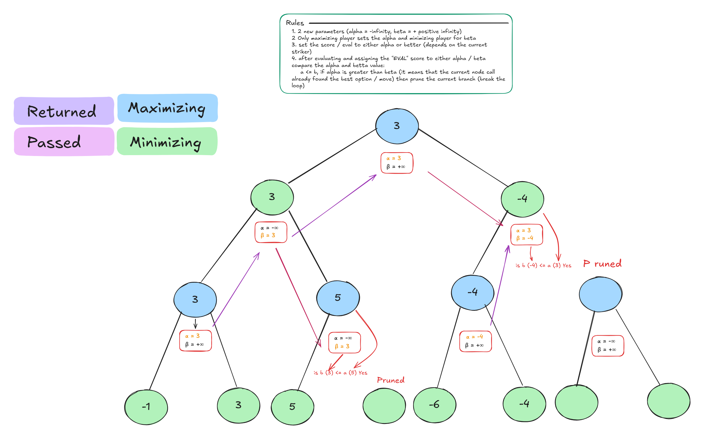

<h1 align="center">alpha-beta-pruning</h1>

<p align="center">
  A tic-tac-toe engine that solves every move twice — once with plain minimax, once with alpha-beta pruning — checks that both answers agree, and shows you how many nodes the pruning threw away.
</p>

<p align="center">
  
  
  
</p>

<p align="center">
  
</p>

<p align="center"><sub>Drawn in Excalidraw — <a href="preview.png">view full size</a> · <a href="preview.excalidraw">open the source</a></sub></p>

#### What this is

A terminal tic-tac-toe game where the AI is solved, not guessed. On every turn it scores each legal reply **twice**: once with an unpruned minimax search, once with alpha-beta pruning. If the two scores ever disagree, the game throws. Then it plays randomly among the moves that score best, so equal positions don't always produce the same game.

You play X, the AI plays O. With a full search of the game tree, the AI cannot be beaten — the interesting part is watching the search collapse from tens of thousands of nodes to a few thousand. Two files, 442 lines of TypeScript, no dependencies.

#### What happens on every move

1. You type a cell index from `0` to `8`. The move is checked for bounds and occupancy.
2. The AI loops over every empty cell and scores the resulting position with both searches.
3. The scores are compared; a mismatch throws `Search algorithm mismatch`.
4. The highest-scoring replies are collected and one is chosen at random.
5. The CLI prints node counts, cutoffs, skipped branches, and the reduction percentage.

#### How the AI decides

**Depth-aware evaluation.** A win is worth `10 - depth`, a loss `depth - 10`, and a tie `0` — so the AI prefers to win sooner and lose later. [`src/lib/game.ts:114-128`](src/lib/game.ts#L114-L128)

**Center-first move order.** The search tries `[4, 0, 2, 6, 8, 1, 3, 5, 7]` instead of `0..8`. Good moves first means more cutoffs, sooner. [`src/lib/game.ts:61`](src/lib/game.ts#L61)

**Random tie-break.** Among moves with the same best score, one is picked at random. Optimal play, non-repetitive games. [`src/lib/game.ts:263-271`](src/lib/game.ts#L263-L271)

#### The code that does the pruning

> **The rule.** While maximizing, α is the best score the maximizer can already guarantee. While minimizing, β is the best the minimizer can guarantee. If `β ≤ α`, the current branch can never change the final answer, so the loop breaks.

```ts
// src/lib/game.ts:167-179
            if (maximizingPlayer) {
                bestScore = Math.max(bestScore, score)
                alpha = Math.max(alpha, bestScore)
            } else {
                bestScore = Math.min(bestScore, score)
                beta = Math.min(beta, bestScore)
            }

            if (beta <= alpha) {
                stats.cutoffs++
                stats.skippedMoves += slots.length - i - 1
                break
            }
```

The counters in that last block are also how the analytics stay honest: `cutoffs` counts the breaks, and `skippedMoves` counts the siblings that were never searched.

**What alpha-beta adds to plain minimax.** Same evaluation, same move order, same recursion — only the bounds and the break are new:

```diff
     #minimax(
         board: Board,
         depth: number,
+        alpha: number,
+        beta: number,
         maximizingPlayer: boolean,
         stats: SearchStats
     ): number {
 ...
             const score = this.#minimax(
                 board,
                 depth + 1,
+                alpha,
+                beta,
                 !maximizingPlayer,
                 stats
             )

             if (maximizingPlayer) {
                 bestScore = Math.max(bestScore, score)
+                alpha = Math.max(alpha, bestScore)
             } else {
                 bestScore = Math.min(bestScore, score)
+                beta = Math.min(beta, bestScore)
             }

+            if (beta <= alpha) {
+                stats.cutoffs++
+                stats.skippedMoves += slots.length - i - 1
+                break
+            }
         }
```

The unpruned search is not dead code — it is the control group that makes the next table meaningful. And because both run on every move, the game doubles as a correctness test.

#### Measured, not estimated

One complete game, played against the compiled `dist/` build on Node 26.13.0. The numbers come from the engine's own counters (`stats.nodesVisited`, `stats.cutoffs`), not from instrumentation added for this README:

| AI turn | Minimax nodes | α-β nodes | Cutoffs | Branches skipped | Nodes saved |
| :------ | ------------: | --------: | ------: | ---------------: | ----------: |
| 1 — after X takes a corner | 59,704 | 4,802 | 1,737 | 2,911 | **91.96%** |
| 2 — mid-game | 934 | 195 | 76 | 120 | **79.12%** |
| 3 — the winning move | 29 | 19 | 6 | 6 | **34.48%** |

Terminal nodes tell the same story: 27,732 → 1,834 on the opening move.

Two things worth knowing about these numbers:

- Both searches run once per **candidate reply**, so the counts are summed across the root moves the AI considered (8 on the opening, then 6, then 4) — not a single traversal.
- Pruning pays most when there is most left to search. By the last move there are only four empty cells, so 34% is the expected shape of the curve, not a worse algorithm.

The percentage is computed in `#aiStrike` as `(minimaxNodes - alphaBetaNodes) / minimaxNodes`. [`src/lib/game.ts:273-280`](src/lib/game.ts#L273-L280)

#### Run it locally

```bash
git clone git@github.com:Aicyraa/alpha-beta-pruning.git      # SSH
# or
git clone https://github.com/Aicyraa/alpha-beta-pruning.git   # HTTPS

cd alpha-beta-pruning
```

Install, build, play:

```bash
pnpm install
pnpm exec tsc     # compiles src/ into dist/
pnpm start
```

Requires Node 20+ and pnpm (the repo pins `pnpm@12.18.0` via `packageManager`). There are no runtime dependencies.

The board is indexed like this — type the number where you want to move, or `q` to quit:

```text
 0 | 1 | 2
---+---+---
 3 | 4 | 5
---+---+---
 6 | 7 | 8
```

#### Project layout

```text
.
├── src/
│   ├── index.ts          CLI: board rendering, input loop, analytics output
│   └── lib/game.ts       state, evaluation, minimax, alpha-beta, self-check
├── preview.excalidraw    the drawing above (editable)
├── preview.png           rendered preview used by this README
├── package.json          scripts and the pinned pnpm version
└── tsconfig.json         strict, ES2022, NodeNext
```

#### License

ISC, as declared in [`package.json`](package.json).
